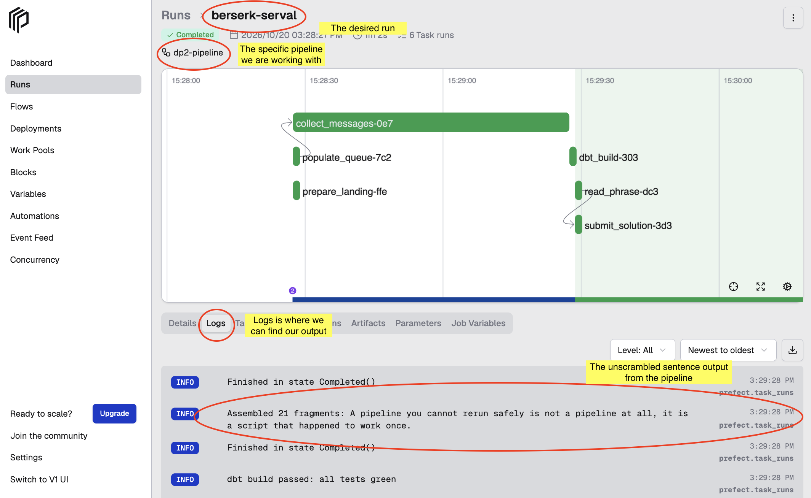
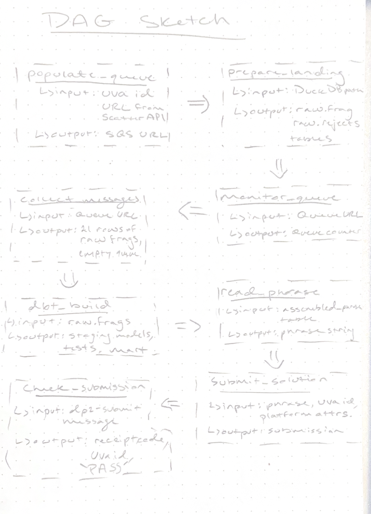
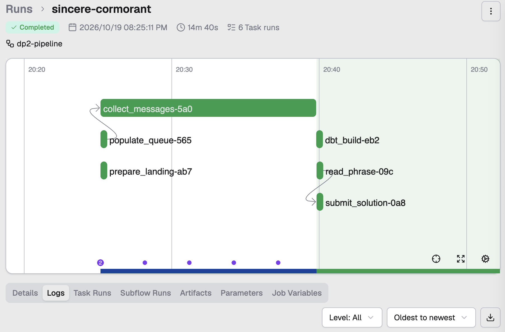
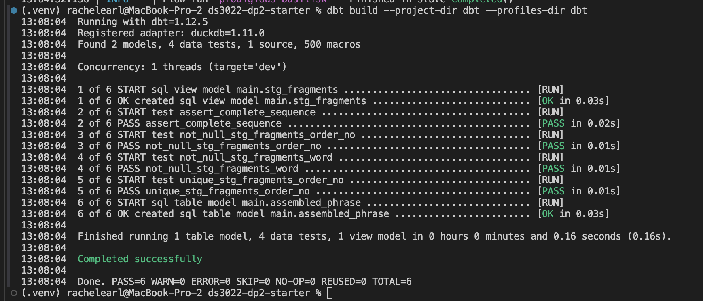
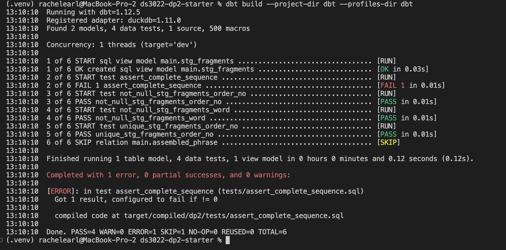
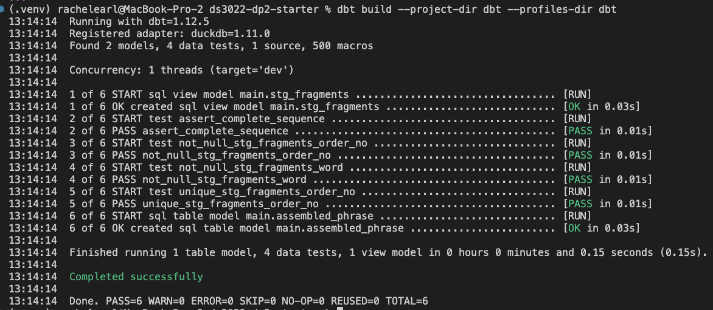
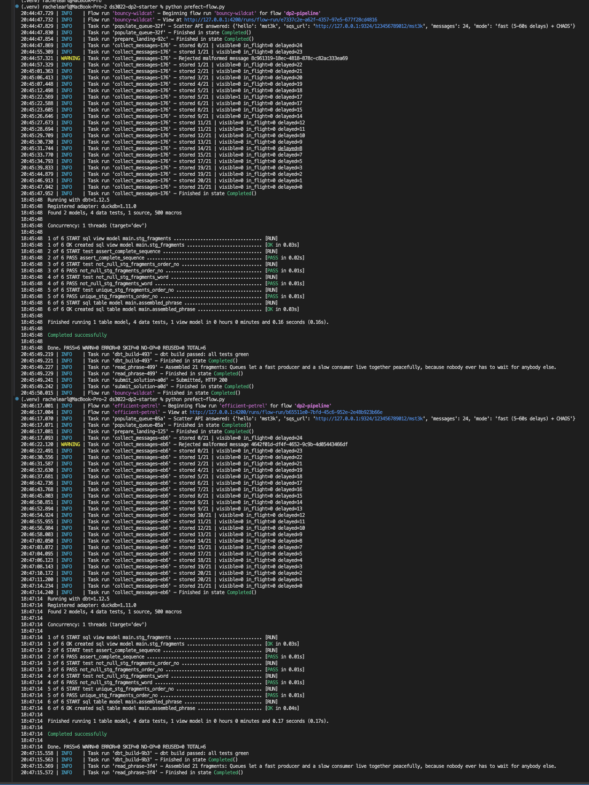

# DS3022 - Data Project 2 (Fall 2026)

Repo url: https://github.com/swt2vv/ds3022-dp2-starter

---

Name: Rachel Earl

Student ID: swt2vv

Due Date: 10/20/26


# Setup and Run Instructions

## 1. Clone Repository in Bash

```bash
git clone https://github.com/swt2vv/ds3022-dp2-starter
cd ds3022-dp2-starter
```

## 2. Create Virtual Environment, Install Dependencies, and Create .env File in Bash

```bash
cd ds3022-dp2-starter
python3 -m venv .venv
source .venv/bin/activate
pip install -r requirements.txt
cp .env.example .env
```

Windows:

```bash
cd ds3022-dp2-starter
py -3.12 -m venv .venv
.venv\Scripts\Activate.ps1
pip install -r requirements.txt
copy .env.example .env
```

** In the newly created .env file, change the UVA_ID to your specific student ID.


## 3. Set Up Four Terminals With Necessary Programs All in Bash

### i. Start the SQS emulator (in Terminal 1 AKA T1)


```bash
moto_server -p 9324
```

### ii. Start the scatter API (T2)

```bash
python kit/scatter_api.py
```

### iii. Check everything (T3)

```bash
python kit/smoke_test.py
```

### iv. Start the Prefect server (T4)

```bash
prefect config set PREFECT_API_URL="http://127.0.0.1:4200/api"
prefect server start
```

## 4. Run the Pipeline in Bash

```bash
python prefect-flow.py
```

## 5. View Dashboard

Within T4, open `http://127.0.0.1:4200` to view the Prefect dashboard. Open the
`dp2-pipeline` flow and select a run to inspect its task states and logs. The
assembled phrase appears in the `read_phrase` task log.



---

# Architecture

## Tool Roles

### Moto_server/SQS

**Role:**

`moto_server` is a local Simple Queue Service (SQS) emulator which stores
messages temporarily and allows for sending, delaying, receiving, and deleting
messages.

**What Would Be Lost Without Moto/SQS?**

Without the local SQS service, the flow would not have a queue from which to
receive the fragments or to which it could submit the solution.

### Prefect

**Role:**

Prefect server stores information about the flow runs and tasks within the
flow. It organizes the information in an interactive dashboard with logs,
runtimes, and flow charts. The flow in `prefect-flow.py` establishes the task
order and Prefect executes and monitors those tasks.

**What Would Be Lost Without Prefect?**

Without Prefect, the Python functions could still be called manually, but
there would be no central workflow, task-level monitoring, or dashboard
evidence that the pipeline completed successfully.

### API

**Role:**

`scatter_api.py` is a puzzle generator program which creates 21 SQS messages,
assigns each an `order_no` and a word, applies a delay, and returns the queue
URL.

**What Would Be Lost Without the Scatter API?**

Without the Scatter API, the project would not have an automated source of
delayed fragment messages to process.

### DuckDB

**Role:**

DuckDB is the local database used to store valid fragments in `raw.fragments`
and malformed messages in `raw.rejects`. It provides the SQL tables that dbt
reads later in the pipeline.

**What Would Be Lost Without DuckDB?**

Without DuckDB, the flow would not have a persistent SQL landing area for dbt
to transform and test.

### dbt

**Role:**

dbt transforms the raw fragments into staging and mart models. It converts
`order_no` from text to an integer, trims spaces in `word`, removes duplicate
rows, runs the tests, and builds the final ordered phrase.

**What Would Be Lost Without dbt?**

Without dbt, the flow could technically assemble text in Python, but it would
lose the documented SQL transformations and the quality gate that prevents
submission when the fragment set is incomplete or inconsistent.

## DAG Diagram




## Task Boundaries and Dependencies

| Task | Purpose | Input | Output | Depends on |
|---|---|---|---|---|
| `populate_queue` | Ask the Scatter API to create the delayed messages | UVA ID and Scatter API URL | SQS queue URL | None |
| `prepare_landing` | Create the DuckDB raw landing tables | DuckDB path | `raw.fragments`, `raw.rejects` | `populate_queue` |
| `monitor_queue` | Monitor visible, in-flight, and delayed counts | Queue URL | Queue counters | `prepare_landing` |
| `collect_messages` | Receive, persist, and delete messages | Queue URL | 21 rows of raw fragments, empty queue | `monitor_queue` |
| `dbt_build` | Clean, deduplicate, test, and assemble | `raw.fragments` | Staging model, tests, and mart | `collect_messages` |
| `read_phrase` | Read the tested phrase from the mart | `assembled_phrase` table | Phrase string | `dbt_build` |
| `submit_solution` | Send the phrase and check HTTP 200 | Phrase, UVA ID, platform | Accepted submission | `read_phrase` |
| `check_submission.py` | Verify the submitted answer | `dp2-submit` message | `PASS` and receipt code | `submit_solution` |

**monitor_queue is included in the DAG sketch and the table above for explanation purposes, however, in the final pipeline flow, monitor_queue is not called because collect_messages handles the tasks of monitoring the queue.**

## Pipeline Overview

1. Run the necessary programs (i.e. `moto_server`, `scatter_api.py`, `prefect-flow.py`)

2. Run `python prefect-flow.py` to run the pipeline of tasks.
    i. It populates the queue by sending an HTTP POST request to the Scatter API, which creates the queue and the 21 messages, assigns them a word and order number, delays the messages, and returns the queue URL to the flow.
    ii. It prepares DuckDB through the `prepare_landing` function, which creates `raw.fragments` and `raw.rejects` tables, ready to receive the data generated by the Scatter API.
    iii. It receives fragments through the `collect_messages` function, which requests all message attributes and extracts `order_no` and `word`.
    iv. It persists valid raw data in `raw.fragments` and malformed messages in `raw.rejects`. It then deletes each message after it is handled. This continues until 21 distinct fragments are stored and no messages are visible, in flight, or delayed.

    The final output is `stored 21/21 | visible=0 in_flight=0 delayed=0`.

3. Run dbt transformations with `dbt build --project-dir dbt --profiles-dir dbt`.
    i. dbt reads the `raw.fragments` table, converts `order_no` from text to an integer, trims spaces from `word`, and removes exact duplicate rows.
    ii. It tests for `not_null`, `unique`, and the singular contiguous sequence with `assert_complete_sequence.sql`. This means that the order numbers are complete with no gaps. When the tests succeed, dbt creates a one-row result containing the fragment count and phrase.
    iii. If any test fails, the flow cannot continue to the submission step. If the tests pass, `read_phrase()` reads the phrase from dbt.

4. Submission
    i. `submit_solution(phrase)` sends the phrase to the separate `dp2-submit` queue, which has `uvaid`, `phrase`, and `platform` attributes, and checks that SQS returns HTTP 200. When we run `python kit/check_submission.py`, it verifies the submission and prints `PASS` with a receipt code.


# Polling Strategy

## Chosen Strategy

The pipeline first uses fixed-interval polling. Every 5 seconds, the monitoring task calls get_queue_attributes() and checks the `ApproximateNumberOfMessages`, `ApproximateNumberOfMessagesNotVisible`, and `ApproximateNumberOfMessagesDelayed` counters. collect_messages() performs this monitoring in the flow, while monitor_queue() remains available as the separate Checkpoint A monitoring task. It then uses SQS long polling `(WaitTimeSeconds=10)` when receiving messages, reducing unnecessary receive requests and improving efficiency.

Polling continues until the delayed message count reaches zero, indicating that all 21 scattered fragments have been released into the queue.

## Why This Strategy

The 5-second interval provides a balance between responsiveness and resource usage. Polling too frequently would generate unnecessary API requests and increase load on the queue service, while polling too infrequently would increase pipeline completion time.

Since messages are delayed by the scatter service and must eventually be released, a lightweight periodic check is sufficient.

## Alternatives Considered

### Option 1: Faster Polling

Rejected because it generates significantly more API requests while providing little practical improvement in completion time.

### Option 2: Slower Polling

Rejected because it would increase latency and make the pipeline wait much longer than necessary after messages become available.

### Option 3: Event-Based/Webhooks

Rejected because the assignment infrastructure exposes an SQS queue that must be monitored. No callback or webhook mechanism is provided, making polling the appropriate solution.

# Receive → Persist → Delete Order

## Processing Sequence

For each message, the flow:

1. Receives the message from SQS.
2. Requests all message attributes and extracts `order_no` and `word`.
3. Validates the extracted values.
4. Inserts valid data into `raw.fragments`, or records a malformed message in
   `raw.rejects`.
5. Deletes the message from SQS using its `ReceiptHandle`.

## Why This Order Matters

The flow persists the message before deleting it from the temporary SQS queue.
This prevents data loss if the database insert fails or the flow crashes.
Deleting the message after persistence also prevents it from remaining in the
queue and being delivered repeatedly.

SQS provides at-least-once delivery, so a crash after persistence but before
deletion can still cause an exact duplicate to be delivered later. The dbt
staging model uses `select distinct` so an identical redelivery contributes
only one logical fragment. A different word for the same `order_no` is a data
conflict and causes the dbt tests to fail.

# Idempotency

An exact duplicate message is treated as a harmless redelivery. The raw table
may contain the duplicate, but the staging model removes identical
`(order_no, word)` rows with `select distinct` before the phrase is assembled.

A different word for the same `order_no` is not treated as harmless. It is a
conflict, so the `unique` test on `order_no` and the sequence test prevent the
flow from submitting an ambiguous phrase.

If the flow crashes after receiving but before persistence, the message has
not been deleted and SQS can make it visible again. If it crashes after
persistence but before deletion, the data is already safe and any exact
redelivery is deduplicated by dbt. If it crashes after deletion, the fragment
should already be in DuckDB because persistence occurs first.

# Results

## Dashboard Output

The full-delay run shows the flow collecting all 21 fragments, reaching zero
queue counters, running dbt, and submitting the phrase.



## dbt Output

The successful dbt build creates the staging and mart models and passes the
generic and singular tests.




The intentionally fails:




Restored dbt run:



## Receipt Code

```text
0AC43ACD33
```

The receipt was produced by:

```bash
python kit/check_submission.py
```

# Chaos Round

The chaos checks tested the behavior needed for duplicate and malformed
messages.

## What Broke?

An exact duplicate can happen because SQS uses at-least-once delivery. An invalid message can also be missing a required attribute or contain a non-numeric `order_no`. Either case can make raw ingestion unsafe if it is not handled explicitly.

## Root Cause

Queue consumers must assume that delivery can be repeated and that input may not always have the expected shape. A raw row also cannot be assumed to be unique merely because the message was received once.

## Fix

The `parse()` helper validates the required attributes and rejects invalid messages. Rejected messages are put in the `raw.rejects` table and like always are deleted from the queue so that they do not remain in flight or repeatedly reappear.

Exact duplicate fragments are handled by `select distinct` in the dbt staging model. A conflicting second word for the same position is not silently accepted; the dbt tests fail and prevent submission.

The collection loop verifies that the final visible, in-flight, and delayed counters are all zero.

### The chaos evidence:



Message processing must assume retries and invalid input. Saving before deleting protects against data loss, while validation and dbt tests prevent bad or incomplete data from becoming a submitted phrase.
